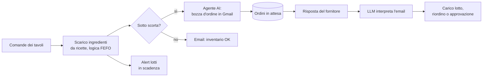

# Agentic Inventory for Restaurants

Sistema agentico che automatizza la gestione dell'inventario e degli ordini ai fornitori di un ristorante, dalla comanda al tavolo fino al carico della merce in magazzino.

Progetto sviluppato per la tesi sperimentale di laurea triennale in **Digital Economics and Business**, relatore Prof. Alex Mircoli (Università Politecnica delle Marche, luglio 2026).

**Stack:** n8n (self-hosting su VPS Hostinger) · MariaDB · Google Gemini via API · Gmail API 

---

## Il problema

In molte cucine l'inventario si gestisce ancora a mano: si contano le scorte a fine servizio, si scrivono gli ordini ai fornitori uno per uno, si leggono le loro risposte e si aggiorna il magazzino. Il progetto nasce dalla mia esperienza in brigata, dove gestivo ordini e rifornimenti della linea: ho provato ad automatizzare l'intero ciclo lasciando alle persone solo le decisioni che contano.

## Come funziona

Il sistema è composto da due workflow n8n che lavorano sullo stesso database.

### Workflow 1 · Inventario e riordino

File: [`1-agentic-inventory-and-ordering.json`](1-agentic-inventory-and-ordering.json)

1. Legge le comande delle ultime 8 ore (un servizio) e calcola gli ingredienti consumati tramite le ricette di ogni piatto.
2. Scala i lotti in magazzino con logica **FEFO** (*first expired, first out*). I lotti esauriti vengono archiviati.
3. Ricalcola giacenze e **costo medio ponderato** di ogni prodotto.
4. Individua i prodotti sotto la scorta minima e calcola la quantità da ordinare.
5. Raggruppa i prodotti per fornitore preferito. Un **agente AI** (Gemini) scrive una sola email d'ordine per fornitore, tenendo conto delle note sul fornitore (es. giorni di consegna, referenti), e la salva come **bozza in Gmail**: l'invio resta una scelta del personale.
6. Registra l'ordine come "in attesa", collegato al thread Gmail per riconoscere la risposta.
7. Invia un alert per i lotti che scadono entro 3 giorni.

### Workflow 2 · Risposte dei fornitori e aggiornamento del magazzino

File: [`2-supplier-replies-and-inventory-update.json`](2-supplier-replies-and-inventory-update.json)

1. Ogni 5 minuti controlla le email non lette e le abbina agli ordini in attesa tramite il thread Gmail.
2. Un **LLM** interpreta l'email (testo libero) e restituisce per ogni prodotto un JSON strutturato: stato, quantità confermata, prezzo, numero di lotto, data di consegna.
3. In base allo stato:

| Stato | Cosa fa il sistema |
|---|---|
| **Confermato** | Stima la scadenza secondo le shelf-life HACCP, carica il nuovo lotto, aggiorna giacenze e costo medio. |
| **Parziale** | Carica la quantità ricevuta e ordina la differenza al fornitore secondario. Se non esiste, avvisa il responsabile. |
| **Prodotto sostitutivo** | Invia al responsabile un'email con i pulsanti **Accetta / Rifiuta** (*human-in-the-loop*). Se accetta, carica il sostitutivo. Se rifiuta, contatta il fornitore secondario. |
| **Non disponibile** | Ordina al fornitore secondario. Se non esiste, avvisa il responsabile e segna l'ordine come non evadibile. |

### Database

File: [`automated_inventory_restaurants.sql`](automated_inventory_restaurants.sql)

Schema relazionale MariaDB a 9 tabelle, progettato da zero:

| Tabella | Contenuto |
|---|---|
| `menu` | Piatti, prezzi e categorie |
| `recipe` | Distinta base: quantità di ogni ingrediente per piatto |
| `orders` | Comande dei tavoli (simulano il gestionale di cassa) |
| `rest_inventory` | Anagrafica prodotti, giacenza, scorta minima, costo medio |
| `batch` | Lotti in magazzino con quantità, scadenza e costo |
| `batch_archive` | Storico dei lotti esauriti |
| `suppliers` | Fornitori con contatti e note |
| `supplier_products` | Listini: codici, prezzi e fornitore preferito per prodotto |
| `pending_orders` | Ordini ai fornitori e relativo stato |

Le query usano transazioni e *window function* (es. somma cumulata dei lotti per applicare la logica FEFO).

## Come provarlo

1. Importa `automated_inventory_restaurants.sql` in un database MariaDB/MySQL (es. con phpMyAdmin).
2. In n8n importa i due file `.json` dei workflow.
3. Crea le credenziali: MySQL (database), Gmail OAuth2, Google Gemini API.
4. Sostituisci i segnaposto:
   - `manager@example.com` → l'email di chi riceve gli alert;
   - `https://TUO-SERVER-N8N` → l'indirizzo della tua istanza n8n (link Accetta/Rifiuta).

I dati nel database sono di prova: fornitori, email e numeri di telefono sono fittizi.

## Limiti e sviluppi futuri

- È un prototipo testato su un ristorante dimostrativo con dati di prova, non in produzione.
- Le query SQL inseriscono i valori direttamente nel testo: in produzione andrebbero usate query parametrizzate.
- La scadenza stimata dall'LLM è un supporto, non sostituisce il controllo del personale sull'etichetta.
- Le comande sono simulate: il passo successivo è l'integrazione con un gestionale di cassa reale.
- Possibili estensioni: previsione dei consumi in base allo storico, confronto automatico dei prezzi tra fornitori, gestione di più punti vendita.

## Autore

**Davide Boria** · Laurea triennale in Digital Economics and Business, Università Politecnica delle Marche (107/110)
